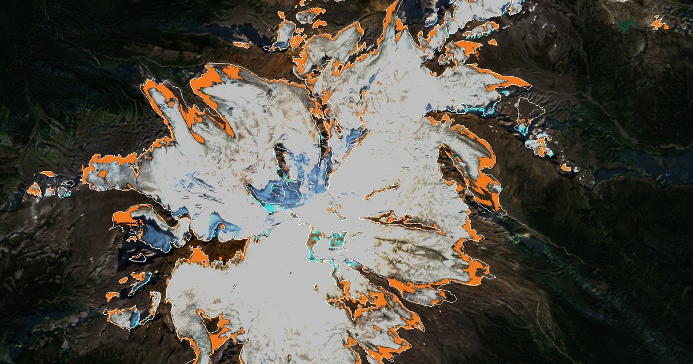
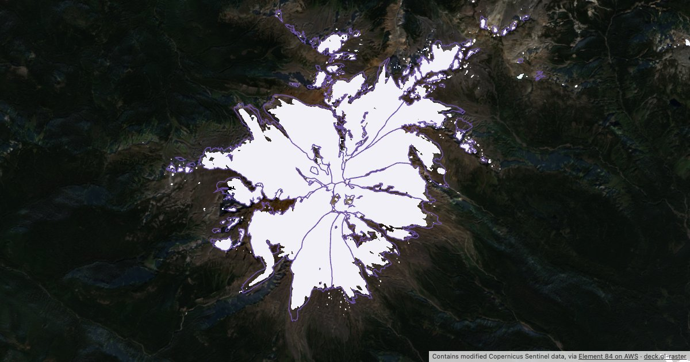
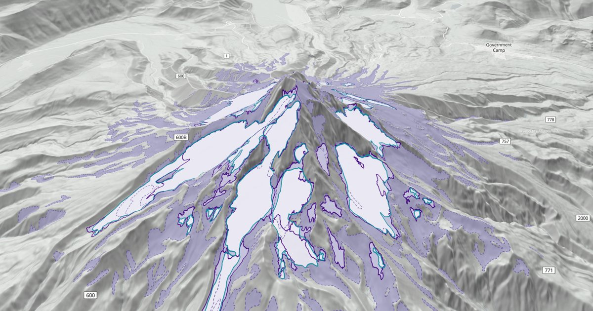
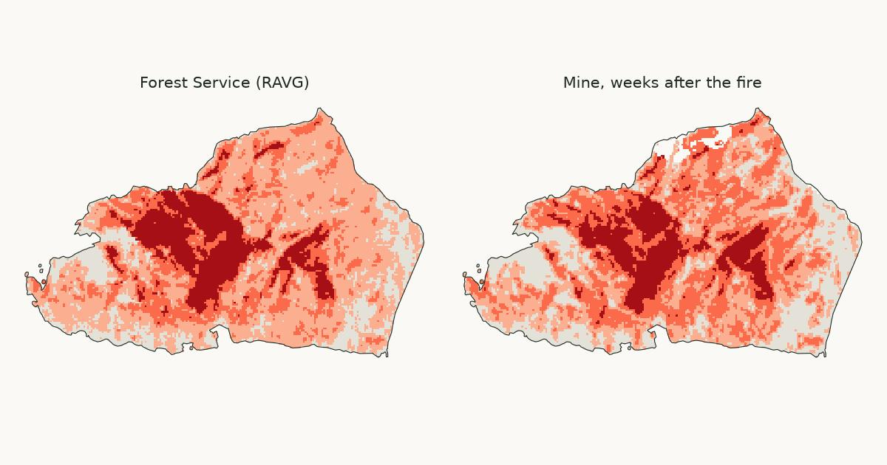

These are notes on questions I am curious about: quick experiments, first results, not papers. Many are notebooks,
so the numbers and figures can be rebuilt from public data. I would like to hear about what I got wrong.

:::{note} Machine-drafted
I draft these notes with help from AI language models, working from analysis code in public repositories.
:::

<!-- BEGIN cards (scripts/build_index.py) -->
## Glaciers

::::{grid} 1 2 2 3
:::{card} What is happening to Mount Baker's glaciers?
:link: glaciers/mount-baker.md
:header: 2026-10-23
:footer: Sentinel-2 · Landsat · Mount Baker · whatcom.land

Maps from 1975 and 2015, and satellite images every late summer since
:::
:::{card} Mount Baker's bright ice, computed in your browser
:link: glaciers/baker-bright-ice.md
:header: 2026-10-22
:footer: Sentinel-2 · deck.gl-raster · Mount Baker · cloud-native

An experiment with deck.gl-raster and Sentinel-2
:::
:::{card} What is happening to Mount Hood's glaciers?
:link: glaciers/mount-hood.md
:header: 2026-10-21
:footer: Landsat · Mount Hood · Oregon

Satellite images from 2013 to 2026, checked against maps made on the ground
:::
::::

## Fires

::::{grid} 1 2 2 3
:::{card} How badly did the Perry fire burn?
:link: fires/perry-severity.md
:header: 2026-10-22
:footer: Sentinel-2 · burn severity · North Cascades · whatcom.land

Four satellite maps of one fire in the North Cascades, and what they teach my own method
:::
::::
<!-- END cards -->

Related: [whatcom.land](https://whatcom.land/glaciers) maps Mount Baker's glaciers in 1974–75, 2015 and 2025.
